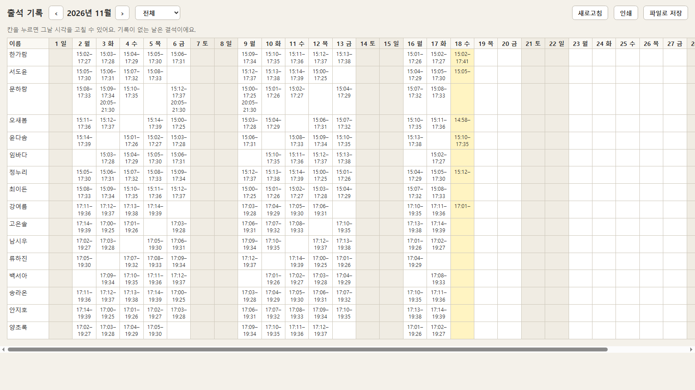

# 출석부 (Attendance Table)

학원 한 곳을 위해 만든 출석 프로그램입니다. 선생님 PC에서 Node 프로세스 하나가 돌고, 교실 TV에 학생 이름을 크게 띄웁니다. 학생은 학원에 둔 출석 기기(삼성 갤럭시)에서 휴대폰번호 뒷 4자리를 눌러 출석합니다. 선생님은 zip을 풀고 `start.bat`을 더블클릭하면 되고, 학생은 아무것도 설치하지 않습니다.

## 푼 문제

- **교실 TV 현황판**: 학생마다 한 칸씩, 도착 전은 회색, 학원에 있으면 초록, 하원하면 빨강으로 보입니다. 칸에는 등원·하원 시각이 함께 나옵니다. 한 화면에 8명씩 나눠 보이고, 반을 골라 그 반만 볼 수 있습니다.
- **번호 뒷 4자리로 하는 출석**: 학원 공유기에는 학생 휴대폰을 붙일 수 없어서, 학원에 둔 기기 한 대로 출석합니다. 같은 번호를 쓰는 형제는 이름을 골라 출석합니다. 하루에 두 번 오는 학생도 방문마다 기록합니다.
- **월별 기록**: 학부모 상담에 쓰도록 날짜별 등원·하원 시각을 남깁니다. 한 달을 표로 보고, 날짜 칸을 눌러 시각을 고치고, A4 가로로 인쇄하거나 Excel로 여는 CSV 파일로 내려받습니다.
- **명단 입력**: 학원은 명단을 Google 스프레드시트에 둡니다. 시트에서 복사해 현황판에 붙여 넣으면 머리줄을 읽어 이름·번호·반 칸을 찾고, 미리보기를 보여 준 뒤 추가합니다.

| 교실 TV 현황판 | 출석 기기 | 월별 기록 |
|---|---|---|
|  |  |  |

화면의 이름, 번호, 학원 이름은 모두 지어낸 것입니다. 시험용 서버에 가짜 데이터를 넣고 헤드리스 Chrome으로 찍었습니다.

## 구조

```
선생님 PC
  start.bat → node server.ts (0.0.0.0:8080)
    data.json    명단, 반, 출석 기기, 날짜별 기록
    backup/      하루 한 번 복사, 30개 보관
  브라우저 → http://localhost:8080          현황판, 2초마다 상태를 받아 다시 그림
  브라우저 → http://localhost:8080/records  월별 기록
      │
      └─ HDMI 또는 화면 복제 → 교실 TV

출석 기기 (갤럭시, 학원 Wi-Fi)
  http://<PC 주소>:8080/k → POST /api/kiosk/*  (등록된 기기 쿠키)
```

- 서버는 TypeScript로, 켜고 끄기만 하는 `server.ts`와 책임별로 나눈 `lib/`의 파일 12개입니다(설정, 저장, 시각, 기록, 명단, 기기, 출석, 네트워크, 교사 기능, 오류, HTTP, 타입). 업무 코드는 HTTP 상태 코드를 모르고, 업무 오류를 400·404·409로 바꾸는 일은 `lib/http.ts`만 합니다.
- 화면은 세 개이고(현황판, 출석 기기, 기록) 프레임워크 없이 순수 JavaScript로 씁니다.
- 데이터는 PC 밖으로 나가지 않습니다. 인터넷이 끊겨도 동작하고, 계정이나 외부 서비스가 없습니다.

## 설계 판단

### Node 내장 모듈만 쓰고, 빌드 단계를 두지 않습니다

선생님은 개발자가 아니고, zip을 푸는 것 말고는 아무것도 설치하지 않습니다. 그래서 실행할 때는 npm 패키지를 하나도 쓰지 않고 `node:` 모듈만 씁니다. 화면에 QR 코드를 그리는 라이브러리(`qrcode-generator`, MIT) 하나만 `public/vendor/`에 복사해 두었습니다. CDN에서 받지 않은 것은 학원 인터넷이 끊겨도 현황판이 떠야 하기 때문입니다.

대가도 있습니다. 라우팅, 입력 검사, 보안 헤더를 프레임워크가 해 주지 않아 직접 씁니다. 요청 본문은 JSON만 받고 64KB까지로 자르며, 이름·번호·시각은 경계 함수(`cleanName`, `cleanPhone`, `cleanVisits` 등)를 거친 뒤에만 업무 코드로 넘깁니다. 응답은 저장된 객체를 그대로 내보내지 않고 필드를 하나씩 골라 만듭니다. 정적 파일은 정해 둔 목록에서만 내주고, 요청 경로를 파일 경로로 바꾸지 않아 경로 탈출이 생기지 않습니다. 화면에는 `script-src 'self'; style-src 'self'` CSP를 걸어 HTML 안에 끼워 넣은 스크립트가 실행되지 않게 했습니다.

### Node가 TypeScript를 바로 실행합니다

서버를 TypeScript로 옮기면서도 "풀고 더블클릭하면 된다"는 납품 방식은 지켜야 했습니다. Node 22.18부터는 `.ts` 파일의 타입을 지우고 바로 실행합니다. 그래서 enum이나 namespace처럼 지울 수 없는 문법은 쓰지 않고, import에 `.ts` 확장자를 적었습니다. 빌드 결과물이 따로 없으니 저장소의 파일이 곧 실행되는 파일입니다.

타입 검사는 개발할 때만 합니다. `package.json`에는 `typescript`와 `@types/node`만 있고, `pnpm typecheck`가 `tsc`를 `strict`, `noEmit`, `erasableSyntaxOnly`로 돌립니다. 마지막 옵션이 Node가 지울 수 없는 문법을 막습니다. 이 파일들은 zip에 넣지 않습니다. 브라우저 코드는 JavaScript로 두었습니다. 화면까지 TypeScript로 쓰면 브라우저용 빌드 단계가 생기기 때문입니다.

### 원자적 저장과 저장 실패 안내

선생님은 검은 콘솔 창을 아무 때나 닫을 수 있고, 망가진 파일이 몇 달 치 기록을 조용히 지우면 안 됩니다.

- 모든 변경은 하나의 큐를 거쳐 `data.json.tmp`에 쓴 뒤 `data.json`으로 이름을 바꿉니다. 중간에 꺼져도 예전 파일이나 새 파일 중 하나가 온전히 남습니다.
- 그날 첫 저장 전에 기존 파일을 `backup/data-YYYY-MM-DD.json`으로 복사하고 30개를 남깁니다.
- 켤 때 읽을 수 없거나 모양이 틀린 파일은 덮어쓰지 않고 `data.json.broken-<시각>`으로 옮겨 둡니다.
- 예전 형식(버전 1, 2) 파일은 읽을 때 새 형식으로 올리고, 올리기 전 원본을 따로 남깁니다.
- 저장에 실패하면 현황판 아래에 실패 시각이 담긴 안내가 뜨고, 다음 저장이 성공할 때까지 사라지지 않습니다. 다음 저장은 메모리의 전체 상태를 쓰므로 그사이 변경도 함께 저장됩니다.
- 서버가 켜져 있는 동안 누가 `data.json`을 바꿔 넣으면, 덮어쓰기 전에 그 파일을 `data.json.replaced-<시각>`으로 남깁니다. 새 버전으로 바꾸는 시험에서 찾은 문제입니다.

데이터베이스를 쓰지 않는 것은 설치 없이 풀어서 쓰는 납품과 내장 모듈만 쓰는 원칙을 지키기 위해서입니다. 학생 500명에 한 달 기록을 채워 재 보니 `data.json`은 273KB였고, 현황판 클릭 응답은 5~7ms였습니다.

### 로그인 대신 "이 PC에서 온 요청"

선생님 계정을 두지 않았습니다. 요청이 루프백 소켓에서 왔고 `Host` 헤더가 `localhost`일 때만 선생님 요청으로 봅니다. `Host`까지 보는 것은 DNS 리바인딩으로 외부 웹 페이지가 선생님 행세를 하지 못하게 하려는 것입니다. 출석 기기용이 아닌 `/api/` 경로는 모두 이 관문을 먼저 거치므로, 새 선생님 기능을 더해도 따로 막는 코드가 필요 없습니다.

출석 기기는 현황판에 뜨는 6자리 일회용 코드(10분, 5번 틀리면 폐기)로 한 번 등록합니다. 등록하면 `HttpOnly` 쿠키를 받고, 서버에는 그 쿠키의 SHA-256 해시만 저장합니다. `data.json`이 새어 나가도 쓸 수 있는 쿠키는 나오지 않습니다.

### 학원 밖에서 온 연결은 요청을 읽기 전에 끊습니다

서버는 `0.0.0.0:8080`에서 받습니다. 공인 IP가 붙은 어댑터가 있거나 방화벽 창에서 공용 네트워크까지 허용하면, 출석 기기 페이지가 인터넷에 열릴 수 있습니다. 그래서 `connection` 이벤트에서 상대 주소를 보고, 루프백, 사설 IPv4 대역(`10/8`, `172.16/12`, `192.168/16`), 링크 로컬(`169.254/16`)이 아니면 요청을 읽기 전에 연결을 닫습니다. 처음 끊은 연결은 콘솔에 한 번 알립니다.

사설 주소에만 바인딩하는 방법도 검토했지만, 수업 중에 DHCP나 Wi-Fi 재연결로 주소가 바뀌면 다시 켤 때까지 기기가 붙지 못해서 고르지 않았습니다. 요청 처리 단계에서 검사하는 방법은 요청을 이미 읽은 뒤이고 라우팅 코드를 건드려야 해서 고르지 않았습니다.

### 휴대용 Node를 넣은 zip으로 납품합니다

학원 PC에 Node를 설치하게 할 수 없어서, zip 안에 휴대용 Node 24(`node\x64\node.exe`)와 라이선스를 넣었습니다. `node.exe`는 매번 nodejs.org의 `SHASUMS256.txt`와 대조합니다. `start.bat`은 이 Node로 서버를 띄우고, 처음 실행할 때 바탕 화면에 "출석부" 바로 가기를 만듭니다. zip에는 실행에 필요한 파일과 선생님용 설명서(`설명서.txt`)만 넣고, 시험과 개발 도구는 넣지 않습니다.

서버를 `.exe` 하나로 묶는 방법도 있었지만, 풀어서 바로 실행하는 납품이 목표여서 zip을 골랐습니다. 선생님이 브라우저를 닫으면 프로그램 전체가 꺼지기를 원해서, 선생님 화면을 모두 닫으면 5초 뒤 서버와 콘솔 창이 함께 꺼집니다. 5초를 기다리는 것은 새로고침으로 꺼지지 않게 하려는 것입니다.

설명서는 메모장으로 바로 여는 텍스트 파일 하나입니다. zip을 풀기 전에도 읽을 수 있도록 Google Drive의 zip 옆에도 올리기로 했습니다. 메모장이 한글을 바르게 보이도록 BOM이 있는 UTF-8과 CRLF로 저장하고, 메모장은 기본으로 줄을 바꾸지 않아서 72칸에서 줄을 나눴습니다.

### QR 방식을 버리고 출석 기기 방식으로 바꿨습니다

처음 구현은 QR이었습니다. TV에 30초마다 바뀌는 일회용 QR을 띄우고, 학생이 자기 휴대폰으로 찍어 처음 한 번 이름을 고르면 그 뒤로는 찍기만 하면 되는 방식이었습니다. 사진을 단톡방에 올려 밖에서 출석하는 일을 막으려고 코드를 계속 바꿨습니다. 고정 QR, GPS, BLE 비콘, 계정 로그인은 각각 사진 전달, 실내 오차, 전용 앱 필요, 존재 증명이 안 된다는 이유로 고르지 않았습니다.

그런데 학원에서 "학생 휴대폰은 학원 공유기에 붙일 수 없다"는 답이 왔습니다. 학생 휴대폰이 PC에 닿지 못하면 QR 방식은 성립하지 않습니다. 그래서 학원에 출석 기기 한 대를 두고 번호 뒷 4자리를 누르는 방식으로 다시 만들었습니다. git 기록에도 그 과정이 남아 있습니다(`dda12b0` QR 첫 구현 → `3d9961e` 출석 기기 방식으로 재구현). 이때 얻은 교훈으로, 학원 환경에 따라 달라지는 기능은 먼저 학원에 묻고 답을 받은 뒤 만들었습니다.

출석 기기 방식에도 한계가 있고, 그대로 받아들였습니다. 출석 기기 앞에서 다른 학생의 뒷 4자리를 아는 사람은 그 학생을 출석시킬 수 있습니다. 같은 번호를 3분 안에 다시 누르면 아무것도 바꾸지 않아서, 실수로 두 번 눌러도 하원 처리되지 않습니다.

## 시험

Node 내장 시험 도구(`node:test`)로 92개를 돌립니다. 2026년 11월 18일 이 PC에서 모두 통과했습니다.

- **격리된 서버**: 시험마다 빈 포트와 임시 폴더의 `data.json`으로 실제 `server.ts`를 띄웁니다. 실제 데이터 파일과 8080 포트를 건드리지 않고, 끝나면 임시 폴더를 지웁니다.
- **가짜 시계**: `node --require tests/fake-clock.js`로 서버의 `Date`를 바꿔 끼웁니다. 시험이 파일에 시차를 쓰면 서버를 다시 띄우지 않고 시각이 옮겨 갑니다. 3분 반복 구간, 자정이 지나면 모두 도착 전으로 돌아가는 것, 새날 첫 저장의 백업을 기다리지 않고 시험합니다.
- **API와 저장**: 교사 관문(LAN에서 온 요청, 다른 `Host`), 기기 등록과 출석 결과 상태 전부, 기록 수정, CSV 파일, 학원 밖 주소 판별, 재시작, 백업 30개, 예전 형식 올리기, 망가진 파일 격리, 저장 실패와 회복을 다룹니다.
- **규모 시험**: 학원 규모인 가짜 60명 명단을 붙여 넣고, 전원 등원·하원, 한 달 기록, 재시작을 거칩니다. 가짜 명단에는 번호를 함께 쓰는 형제, 뒷 4자리만 같은 번호, 번호 없는 학생을 일부러 넣었습니다. 500명 한도와 64KB 요청 상한도 시험합니다.
- **화면 시험**: 설치된 Chrome이나 Edge를 헤드리스로 띄우고, npm 패키지 없이 DevTools 프로토콜을 WebSocket으로 직접 다룹니다. 세 화면의 붙여넣기 해석(Excel, Google 스프레드시트 형식), 기기 등록, 출석 결과, 퇴원, 기록 수정, CSV 내려받기, 60명일 때 쪽 나누기, A4 가로 인쇄 폭, 스크립트 오류가 없는지, CSP가 끼워 넣은 스크립트를 막는지 확인합니다. 브라우저가 없는 PC에서는 건너뜁니다.

시험이 다루지 못하는 것도 있습니다. 실제 갤럭시, 학원 네트워크, 실제 프린터는 아직 확인하지 못했습니다. Google 스프레드시트 붙여넣기는 가짜 300명을 실제 시트에 올려 복사해 붙여 넣는 것으로 한 번 확인했습니다.

## 납품 zip과 새 버전으로 바꾸는 시험

zip은 손으로 만듭니다. 커밋에서 실행 파일만 꺼내 커밋 내용과 비교하고, 휴대용 Node를 넣어 28개 파일로 묶습니다. 마지막 zip(2026년 11월 10일)은 개발 PC에서 이렇게 확인했습니다.

- 탐색기와 같은 방법으로, 이름에 공백과 한글이 든 보통 폴더에 풉니다. 한글 파일 이름(`설명서.txt`)이 그대로 나오는지 보려는 것입니다.
- 더블클릭할 때처럼 `start.bat`을 실행해, 함께 넣은 Node가 8080에서 받는지, 바탕 화면 바로 가기가 생기는지 봅니다.
- 가짜 명단 붙여넣기, 기기 등록, 출석이 버전 3 `data.json`에 저장되는지, 화면에 스크립트 오류가 없는지, 선생님 화면을 모두 닫으면 서버와 창이 꺼지는지 봅니다.

새 버전으로 바꾸는 시험도 했습니다. 쓰던 사람의 폴더를 흉내 내려고 예전 커밋 두 개로 zip을 만들었습니다(데이터 형식 버전 3과 버전 2). 각각 가짜 학생 10명, 반 2개, 등록한 기기 1대, 이틀 치 방문 기록, 고친 기록 하나, 퇴원 한 명을 채웠습니다. 날짜는 가짜 시계로 맞췄습니다. 그다음 새 zip으로 바꾸는 방법 네 가지를 매번 새로 채운 폴더에서 시험해 모두 8번 했습니다.

- 가. 새 폴더에 풀고 `data.json`과 `backup/`을 옮기기
- 나. 쓰던 폴더 위에 풀어 모든 파일 바꾸기
- 다. 나를 현황판을 켜 둔 채로 하기
- 라. 새 폴더를 먼저 켠 뒤 `data.json` 옮기기

파일을 옮기기 전에 현황판을 닫은 경우에는 명단, 반, 학원 이름, 방문 기록, 퇴원, 고친 기록이 모두 이어졌습니다(API 응답 비교). 예전에 등록한 기기 쿠키로 다시 등록하지 않고 출석할 수 있었습니다. 시험에서 문제 네 가지를 찾아 고쳤습니다.

1. 켜 둔 서버 폴더에 옮겨 넣은 `data.json`이 다음 저장 때 덮여 사라졌습니다. 지금은 덮어쓰기 전에 `data.json.replaced-<시각>`으로 남깁니다.
2. 예전 버전이 그날 이미 저장한 뒤에 바꾸면, 형식을 올리기 직전 파일이 백업에 남지 않았습니다. 지금은 올리기 전 원본을 따로 복사합니다.
3. 콘솔 창을 마우스로 누르면 Windows의 빠른 편집 선택 상태가 되어 서버가 멈췄습니다. 지금은 `start.bat`이 그 창의 빠른 편집만 끕니다.
4. 시작 프로그램 폴더의 "출석부" 바로 가기가 예전 폴더를 가리킬 수 있었습니다. 지금은 `start.bat`이 지금 폴더로 맞춥니다.

설명서에는 시험 결과대로 "화면을 모두 닫고, 쓰던 폴더 위에 풀어 모두 바꾸기"(나)를 적었습니다.

아직 학원에 설치하지 않았습니다. 학원의 갤럭시와 Wi-Fi, 방화벽 창, 한국어 Windows에서 나오는 압축 풀기 창의 실제 문구는 납품하는 날 확인합니다. 이 PC는 영어 Windows입니다.

## AI 도구와 함께 일한 방식

코드와 문서는 Claude Code와 함께 썼습니다. 모든 커밋에 `Co-Authored-By: Claude` 줄이 있습니다. 개발자는 무엇을 만들지, 설계안 중 무엇을 고를지, 학원에 무엇을 물을지, 언제 납품할지를 정했습니다.

AI가 기억에 기대지 않고 같은 기준으로 일하도록 저장소 안에 문서를 두었습니다. 이 문서들은 GitHub에 올리지 않습니다.

- **작업 규칙**: 코드를 바꾸기 전에 읽을 파일, 하지 말 것과 그 결과, 실제 `data.json` 대신 임시 데이터로 서버를 띄우는 방법을 적었습니다.
- **설계 기록 20건**: 판단마다 배경, 결정, 대가, 검토했다가 버린 대안을 남깁니다. 결정을 바꿀 때는 예전 항목을 고쳐 쓰지 않고 새 항목을 더합니다. 위 "설계 판단"은 여기서 골랐습니다.
- **미뤄 둔 일 목록**: 알고도 미룬 약점과 학원에 물을 질문을 모았습니다. 버그라고 하기 전에 여기 있는지 먼저 봅니다.
- **한국어 글 규칙**: 화면 문구와 설명서가 번역투 없이 한 가지 말투로 읽히게 맞춤법, 띄어쓰기, 문장 부호를 정했습니다.

일하는 순서도 정해 두었습니다. 작업을 크기에 따라 나눠 거칠 단계를 고르고, 동작한다고 말하기 전에 타입 검사와 전체 시험을 돌리며, 시험이 다루지 못하는 것은 격리된 서버에서 직접 실행해 봅니다. 확인하지 못한 것은 확인하지 못했다고 적습니다. 리뷰는 구현할 때의 설명이 아니라 실제 diff를 보고 합니다. 커밋한 직후에는 설계 기록과 미뤄 둔 일 목록을 그 자리에서 고칩니다.

## 실행

Node 22.18 이상이 필요합니다.

```bash
node server.ts                   # 서버를 켜고 기본 브라우저로 현황판(http://localhost:8080)을 엽니다
NO_OPEN=1 node server.ts         # 브라우저를 열지 않고 켭니다
pnpm install                     # 개발용: TypeScript와 Node 타입(한 번만)
pnpm typecheck                   # server.ts와 lib/ 타입 검사
node --test "tests/*.test.js"    # 전체 시험(화면 시험은 Chrome이나 Edge가 있어야 합니다)
```

출석 기기는 같은 Wi-Fi에서 `http://<PC 주소>:8080/k`를 엽니다. 현황판의 "출석 기기" 창에 주소와 QR 코드가 나옵니다.

개발할 때는 실제 `data.json` 대신 임시 데이터 파일과 다른 포트로 띄워 주세요.

```bash
PORT=8090 NO_OPEN=1 DATA_FILE="/임시/폴더/data.json" node server.ts
```

| 경로 | 내용 |
|---|---|
| `server.ts` | 켜고 끄기: 저장소 열기, 포트 열기, 주소 출력, 학원 밖 연결 끊기 |
| `lib/` | 서버 기능별 파일(저장, 시각, 기록, 명단, 기기, 출석, 네트워크, 교사, 오류, HTTP, 타입, 설정) |
| `public/` | 현황판, 출석 기기, 기록 화면의 HTML·JS·CSS와 QR 라이브러리 |
| `tests/` | 시험과 공통 도구(격리 서버, 가짜 시계, 가짜 명단) |
| `start.bat` | 선생님이 더블클릭하는 실행 파일 |
| `설명서.txt` | 선생님용 설명서 |
| `screenshots/` | 이 README의 화면 이미지 |
