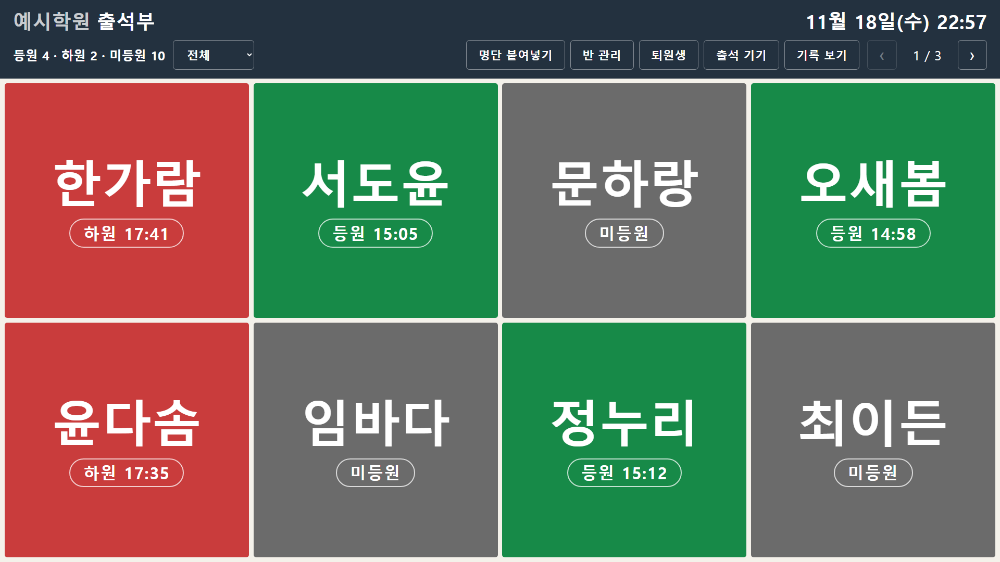
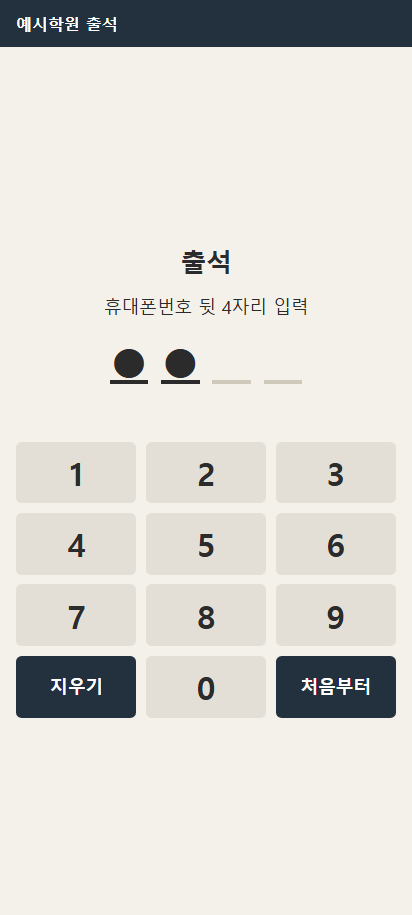
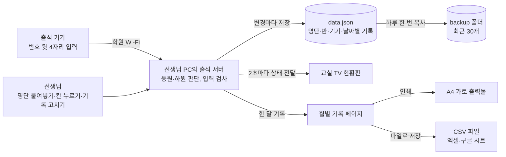

# 출석부: 학원 TV 출석 현황판

학생이 학원에 둔 출석 기기에 휴대폰번호 뒷 4자리를 누르면, 교실 TV에 등원과 하원이 바로 표시되고 날짜별 기록이 자동으로 쌓이는 학원용 출석 프로그램입니다. 스프레드시트에 메모로 적던 출석을 정해진 형식의 기록으로 바꿔, 학부모 상담 때 한 달 기록을 바로 인쇄하거나 엑셀 파일로 넘길 수 있게 했습니다.

## 주요 화면

| 교실 TV 현황판 | 출석 기기 | 월별 기록 |
|---|---|---|
|  |  |  |
| 학생마다 한 칸씩, 도착 전은 회색, 학원에 있으면 초록, 하원하면 빨강으로 보입니다. 칸에 등원·하원 시각이 함께 나옵니다. | 학생은 번호 뒷 4자리만 누릅니다. 4자리가 차면 바로 처리되고, 이름과 "등원했어요"가 크게 나옵니다. | 한 달을 학생 × 날짜 표로 봅니다. 칸을 눌러 시각을 고치고, A4 가로로 인쇄하거나 파일로 저장합니다. |

화면의 이름, 번호, 학원 이름은 모두 지어낸 것입니다.

## 해결한 문제와 핵심 기능

### 기존 방식의 한계

- **기록이 상담에 쓸 수 있는 모양으로 남지 않았습니다.** 학원은 출석을 구글 스프레드시트에 자유 형식 메모로 적어 왔습니다. 학부모 상담에는 날짜별 등원·하원 시각이 필요한데, 메모로는 이를 정리해 보여 주기 어려웠습니다.
- **학생 휴대폰으로 출석할 수 없었습니다.** 학생 휴대폰은 학원 공유기에 연결할 수 없어서, 학생이 각자 휴대폰으로 출석하는 방식은 처음부터 쓸 수 없었습니다.
- **명단이 이미 스프레드시트에 있었습니다.** 학원은 명단을 구글 스프레드시트로 관리하고, 새 프로그램에 다시 입력하기보다 "복잡하지 않으면" 복사해 붙여 넣기를 원했습니다.
- **설치와 관리를 맡을 사람이 없었습니다.** 선생님은 개발자가 아니고, 학원 PC에 개발 도구를 설치하게 할 수 없었습니다. 학생 이름과 번호를 외부 서비스에 올리는 것도 피해야 했습니다.

### 핵심 기능

- **4자리 입력 한 번으로 출석 처리**: 학원에 둔 출석 기기 한 대에서 번호 뒷 4자리를 누르면 그날 처음은 등원, 다음은 하원으로 기록됩니다. 번호를 함께 쓰는 형제는 이름을 고르게 하고, 3분 안에 다시 누르면 아무것도 바꾸지 않아 실수로 두 번 눌러도 하원 처리되지 않습니다. 하루에 두 번 오는 학생도 방문마다 따로 남습니다.
- **교실 TV에서 한눈에 보는 출석 현황**: 출석 기기의 입력이 2초 안에 TV에 반영됩니다. 한 화면에 8명씩 보이고, 반을 골라 그 반만 볼 수 있습니다. 선생님이 칸을 눌러 직접 바꿀 수도 있습니다.
- **상담용 월별 기록 자동 정리**: 출석이 날짜별 등원·하원 시각으로 저절로 쌓입니다. 한 달 표를 A4 가로로 인쇄하거나, 엑셀과 구글 시트에서 여는 CSV 파일로 내려받습니다. 파일에는 휴대폰번호를 넣지 않습니다.
- **스프레드시트 명단을 복사해 붙여 넣기**: 시트에서 복사해 붙여 넣으면 제목 줄을 읽어 이름, 번호, 반 칸을 찾고, 미리보기를 보여 준 뒤 추가합니다. 이미 있는 이름은 건너뛰어 신입생이 생기면 다시 붙여 넣기만 하면 됩니다.
- **설치 없이 켜고, 자동으로 저장하고 백업**: zip을 풀고 `start.bat`을 더블클릭하면 켜지고 바탕 화면에 바로 가기가 생깁니다. 모든 변경은 바로 파일에 저장되고, 하루 한 번 백업을 만들어 최근 30개를 남깁니다. 저장에 실패하면 TV에 안내가 뜨고, 선생님 화면을 모두 닫으면 저장을 마친 뒤 저절로 꺼집니다. 기록은 학원 PC 밖으로 나가지 않습니다.

## 전체 시스템 흐름



서버, 화면, 데이터가 모두 선생님 PC 한 대에 있습니다. 출석 기기만 같은 학원 Wi-Fi로 접속하고, 인터넷이 끊겨도 동작합니다.

## 기술 스택

| 구분 | 사용한 것 | 고른 이유 |
|---|---|---|
| 프론트엔드 | HTML, CSS, JavaScript(프레임워크 없음), QR 라이브러리 qrcode-generator(파일로 포함) | 브라우저용 빌드 단계를 두지 않고, 인터넷이 끊겨도 화면이 뜨게 합니다 |
| 백엔드 | Node.js 22.18 이상(내장 모듈만 사용), TypeScript(빌드 없이 Node가 바로 실행) | 실행에 필요한 외부 패키지가 하나도 없어 학원 PC에 설치할 것이 없습니다 |
| 데이터 저장·인프라 | JSON 파일 하나(`data.json`, 데이터베이스 없음), 날짜별 백업 폴더, 선생님 PC 한 대와 학원 Wi-Fi, 휴대용 Node를 넣은 zip과 `start.bat` | 풀어서 바로 쓰는 납품 방식을 지키고, 데이터를 PC 밖에 두지 않습니다 |
| 자동화·시험 도구 | Node 내장 시험 도구(`node:test`) 92개, 가짜 시계, 헤드리스 Chrome·Edge 화면 시험, TypeScript 타입 검사(`tsc`, pnpm), Claude Code | 실제 데이터를 건드리지 않는 격리된 서버에서 저장, 날짜 넘김, 세 화면의 동작을 반복해 확인합니다 |

요구사항 정리, 설계 결정, 검증은 개발자가 직접 하고, 구현과 시험에는 AI 코딩 도구(Claude Code)를 활용했습니다. 학원 환경에 따라 달라지는 기능은 먼저 학원에 묻고 답을 받은 뒤 만들었습니다. 예를 들어 처음에는 학생 휴대폰으로 QR을 찍는 방식을 만들었다가, 학생 휴대폰을 학원 공유기에 연결할 수 없다는 답을 받고 출석 기기 방식으로 다시 설계했습니다.

## 로컬 실행과 시험

Node 22.18 이상이 필요합니다.

```bash
node server.ts                                  # 서버를 켜고 기본 브라우저로 현황판(http://localhost:8080)을 엽니다
PORT=8090 NO_OPEN=1 DATA_FILE="/임시/폴더/data.json" node server.ts   # 임시 데이터 파일과 다른 포트로 켭니다
pnpm install                                    # 개발용 타입 검사 도구를 받습니다(한 번만)
pnpm typecheck                                  # 서버 코드 타입 검사
node --test "tests/*.test.js"                   # 전체 시험
```

- 현황판은 서버를 켠 PC에서만 열립니다. 출석 기기는 같은 Wi-Fi에서 `http://<PC 주소>:8080/k`를 엽니다. 현황판의 "출석 기기" 창에 주소와 QR 코드가 나옵니다.
- 화면 시험은 PC에 설치된 Chrome이나 Edge를 헤드리스로 띄웁니다. 둘 다 없으면 화면 시험은 건너뜁니다.
- 시험은 매번 빈 포트와 임시 데이터 파일로 서버를 따로 띄우므로, 실제 기록을 건드리지 않습니다.
